# Emissive/Legacy Material Instances

## Prerequisites

[FModel](../../fmodel.md)

[Unreal Engine](../../prerequisites.md)

Plugin Template Project

## Introduction

This guide will show you how to create a material instance with an emissive effect in DaylightGame. For this guide we will simply be adding emissive glow to an existing cosmetic. This guide assumes you have knowledge of basic FModel usage as shown in the **[Textures](../Textures/textures.md)** tutorial. If you do not, we highly suggest familiarizing yourself with that tutorial first.

## Finding what we need

Unlike a single-asset texture replacement, material instances depend on other assets to function. In our case, we only want to add a `_BDE` and change some parameters, but to properly recreate the material asset we're replacing, we will need all the other textures it uses too. 

I've found the following torso which I want to add glow to, `SKM_NK_Torso036`. Now we want to find the material it uses for the jacket; right click it in FModel and choose `Show Metadata`, then scroll down to the `ImportMap` section in the JSON that opened. We can see it has two materials, this is completely normal, but we will need to look through them to find the one that actually looks like the jacket we want to modify. Click on the paths to open the assets. In this case the correct material instance appears to be the second one.

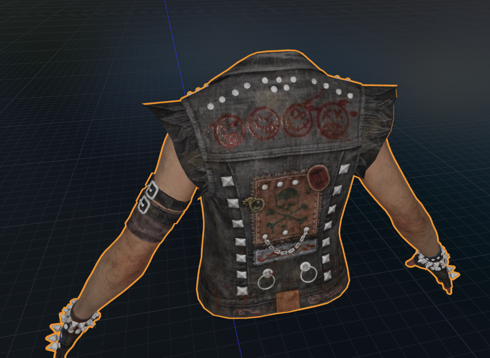

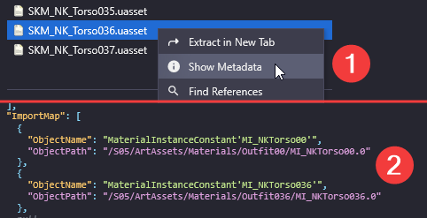

After finding the correct one, close the 3D Viewer that probably opened - you should now have a tab opened in FModel with the JSON of the material instance. Here we can see all the info we need about the parameters, such as the path to the textures used. Extract all the textures, and keep the tab open, we will need to look at the names of the parameters there later.

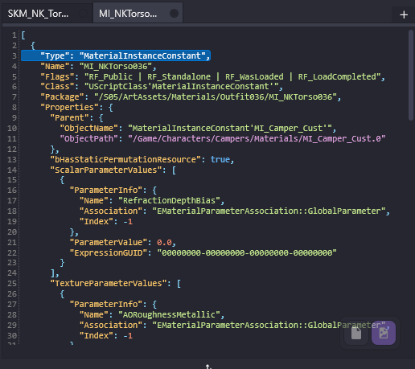

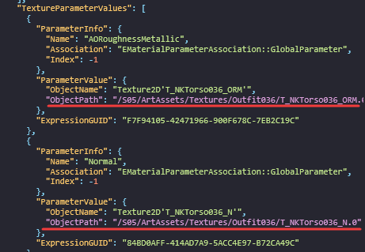

## Creating a BDE texture

In a `_BDE` texture, the blue color channel controls the emissive. Vanilla cosmetics usually keep it around `140` max, as in, `RGB (0, 0, 140)`, lower values mean lower emissive strength for that region. Your final `_BDE` should be blue emissive regions on a completely black background.

To create the BDE shown in the images below, I used the lasso tool to cut the relevant parts to a new layer, then made the cutout the correct blue color. This guide will not teach you the process of that, there are other resources for learning whatever image editor you want to use.

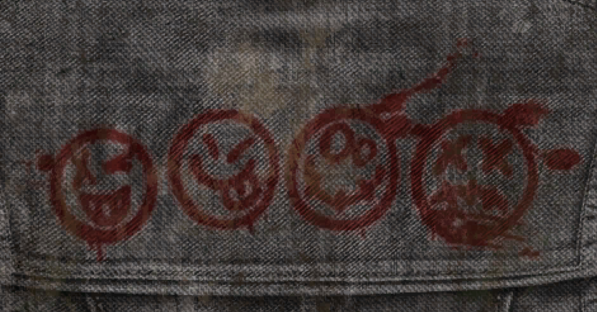

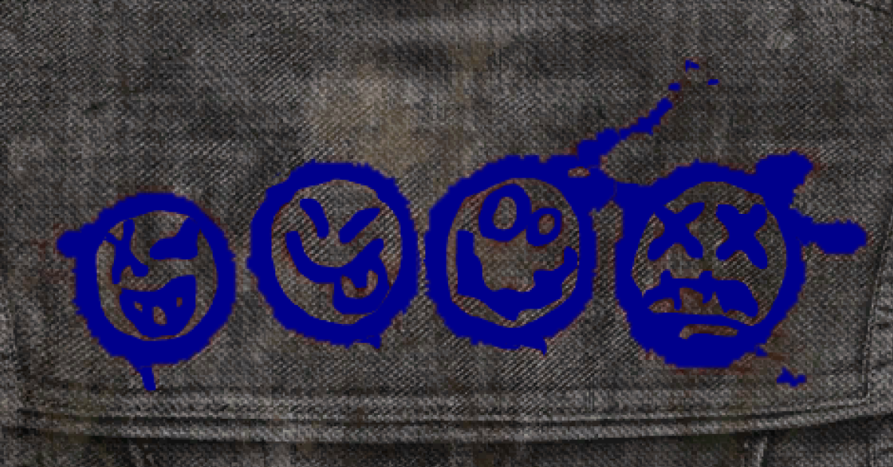

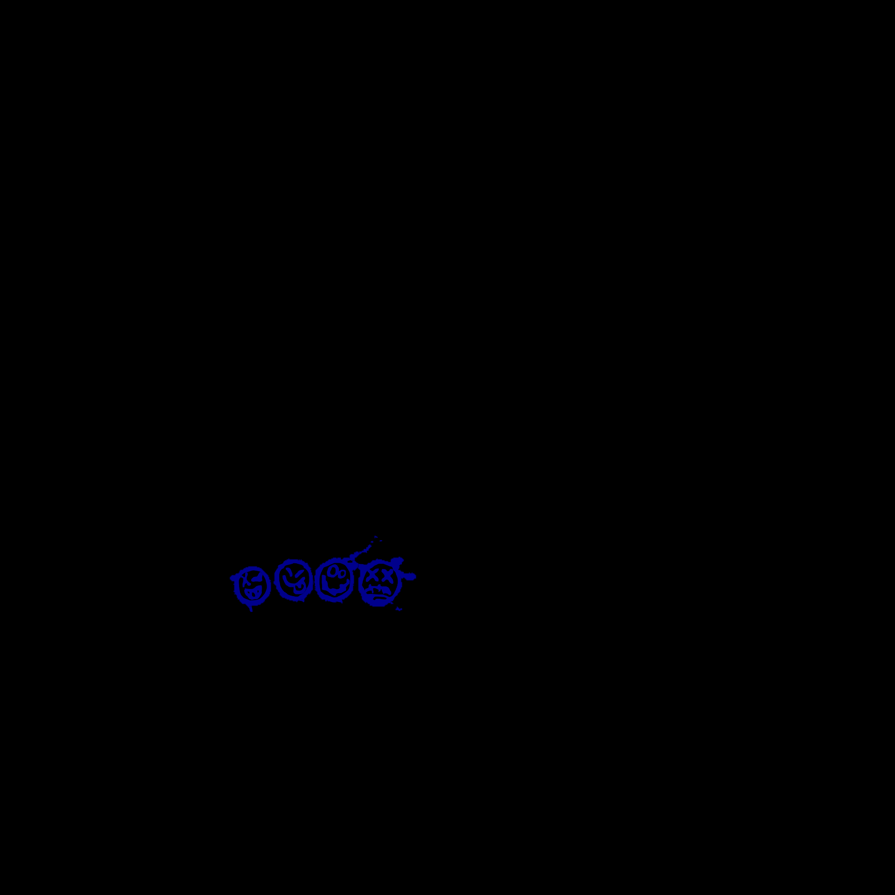{ .center width=300 }

## Creating the material instance

Create a material instance at the correct path so it replaces the asset in-game, make sure to name it the same as it is FModel too. If the folders don't already exist, create them.  

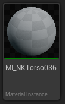

Now, open the material instance you created and change its parent to `MI_Camper_Cust` if you're modding a survivor (as this guide is), and `MI_Slasher_Cust` if killer.

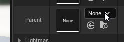{ .center width=300 }

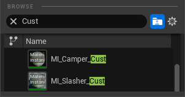{ .center width=300 }

Now you should be able to see that the Scalar, Texture, and Vector parameters categories have appeared at the top of the panel. As you can see, there are quite a few of them, but we will not need to touch most. 

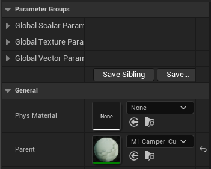{ .center width=300 }

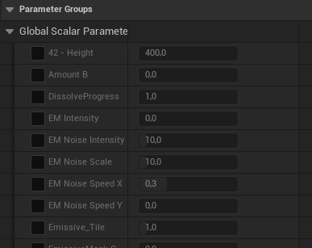{ .center width=300 }

Because we only want to add our emissive without changing anything else on the material instance, we will have to copy the configuration the game uses to our version (except for the parts we want to add/change, like our new BDE). 

Let's look at the material's JSON in FModel again - there we can see the names of parameters we want to copy. For example, under `"ScalarParameterValues": [` I see `RefractionDepthBias` with `"ParameterValue": 0.0,`, and under `"TextureParameterValues": [` I see `AORoughnessMetallic` and a few more. Under these names, we also see the texture that parameter uses in the material instance.

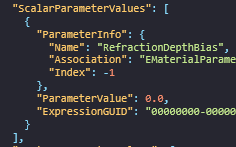

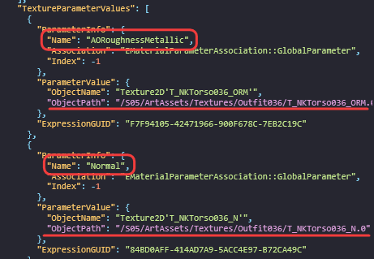

Regarding the texture parameters, we have two options for how to copy them; both options are valid, but with different consequences. We can:

- **A.** Import the same textures ourselves into UE, use them in our material instance, and pack them into our mod.

- **B.** Import them (or any other texture really) into the same path as they are in the game, then *not* pack them into our mod.

Option **A** increases file size and means that if anything changes in the "vanilla" game textures you used, such as the devs maybe fixing an error in them, your mod will *not* reflect that, it will still be using the ones *you* exported today. If this is the behavior you want/are fine with, use option **A**.

Option **B** saves file size and means the opposite of **A**, if the devs change those textures, your mod will reference them and use them along with whatever changes might be made to them. Although, this also brings the risk of the devs making changes that break the mod. In some cases, you might want this behavior, if so, use option **B**. 

For the sake of simplicity, we will be using option **A**, as it is the more common approach and most stable. Let's create a folder for our textures. I simply made mine in the same directory as the material instance because I don't care about keeping things organized for a mod this small.

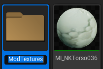

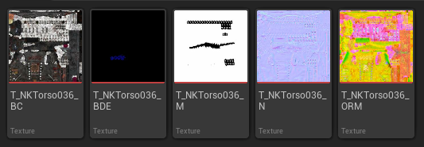

In our material instance, we'll apply the textures to the same parameters which use them in the reference vanilla material, as well as our new BDE. 

!!! note
	You may need to enable `Show Plugin Content` if your textures don't show up (as in this case we placed them in a plugin content directory). To do this, press the cogwheel in the asset selector that pops up when you try to select a texture.

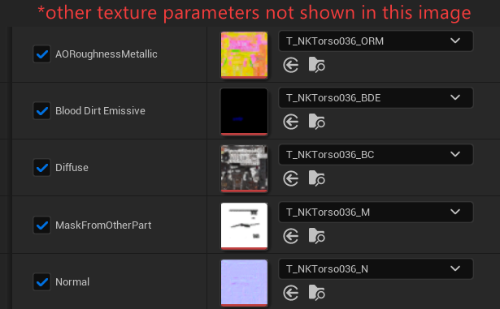

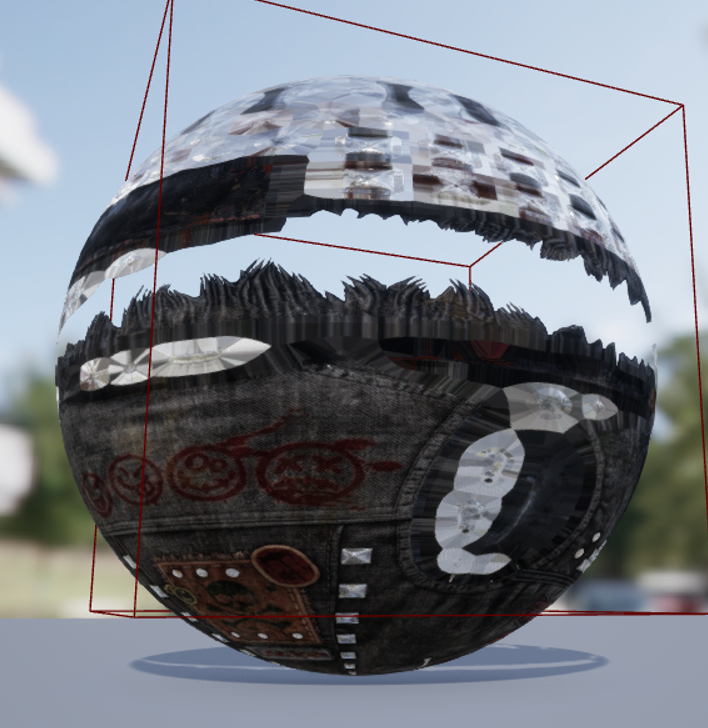

After textures are have been set properly, all that's left is to modify the other parameters related to emissive to get the result you want. 

The `Vector` parameters `EM Color` and `EmissiveTouch` control the color - the latter should be set slightly darker than the former if you want to match how the game devs usually do it.

For `Scalar` parameters: 

- `EM Intensity` - the most basic, you need this to be over 0 for anything to show up. Common value is 3

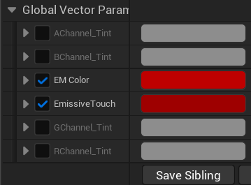

# WIP

---

# WIP

## Enabling the Alpha Texture (OPTIONAL)

Enable Opacity Mask Texture or MaskFromOtherPart depending on whether you're using a Killer or Survivor model and assign your `_M` texture to it.

## Enabling the Emission Texture (OPTIONAL)

Enable Blood Dirt Emissive and assign your `_BDE` texture to it. then enable EM Intensity and change it to your desired amount the higher it is the brighter the emission will be. Enable EM Color and set it to your desired color. See video below for an explanation on what each of the emission values do.

The other Emission settings are usable. Experimenting with them or just copying from materials in the game is recommended.

If you want to make your emission to look like Legacy, simply change your settings to match the following:

| Parameter | Value |
|---|---|
| EM Intensity | 10 |
| EM Noise Intensity | 2 |
| EM Noise Scale | 5 |
| EM Noise ScaleFar | 10 |
| EM Noise Speed X | 0.5 |
| EmissiveMask Custom | 5 |
| Emissive_Tile | 3 |
| EM Color | R = 1, G = 0.552359, B = 0.212663 |
| Emissive Touch | R = 1, G = 0.567833, B = 0.25 |

If you want your emissive area to be solid color instead of having an embers look simply change the Emissive_Tileable_Texture to a blank white box and set EM Noise Intensity to 0. (This texture is included)

- You should enable EmissiveTouch if using emission.
- The Hair material works on both killer and survivor.
- The Hide Head_Mask is just an inverted `_M` texture that only affects killers in first person. so for it Black is unhidden and White is hidden.

### Texture Based EM Colors

These materials work just like `MI_Camper_Cust` and `MI_Slasher_Cust` but the `Emissive_Tileable_Texture` controls the color of the emission instead of `EM Color` and `Emissive Touch`
To use these simply change your parent material to `MI_Camper_Cust_AdamEmission` for survivors or `MI_Slasher_Cust_AdamEmission`
 for killers. 
Set up your emission as usual, However leave `EM Color` and `Emissive Touch` at Their default values, then change `Emissive_Tileable_Texture` to your desired texture.
And you're good to go.