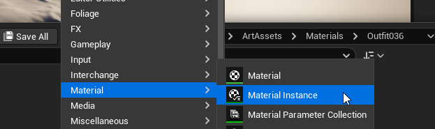

# Emissive/Legacy Material Instances

## Prerequisites

[FModel](../../fmodel.md)

[Unreal Engine](../../prerequisites.md)

Plugin Template Project

## Introduction

This guide will show you how to create a material instance with an emissive effect in DaylightGame. For this guide we will simply be adding emissive glow to an existing cosmetic. This guide assumes you have knowledge of basic FModel usage as shown in the **[Textures](../Textures/textures.md)** tutorial. If you do not, we highly suggest familiarizing yourself with that tutorial first.

## Finding what we need

Unlike a single-asset texture replacement, material instances depend on other assets to function. In our case, we only want to add a `_BDE` and change some parameters, but to properly recreate the material asset we're replacing, we will need all the other textures it uses too. 

I've found the following torso which I want to add glow to, `SKM_NK_Torso036`. Now we want to find the material it uses for the jacket; right click it in FModel and choose `Show Metadata`, then scroll down to the `ImportMap` section in the JSON that opened. We can see it has two materials, this is completely normal, but we will need to look through them to find the one that actually looks like the jacket we want to modify. Click on the paths to open the assets. In this case the correct material instance appears to be the second one.

After finding the correct one, close the 3D Viewer that probably opened - you should now have a tab opened in FModel with the JSON of the material instance. Here we can see all the info we need about the parameters, such as the path to the textures used. Extract all the textures, and keep the tab open, we will need to look at the names of the parameters there later.

## Creating the material instance

Create a material instance at the correct path so it replaces the asset in-game, make sure to name it the same as it is FModel too. If the folders don't already exist, create them.  

Now, open the material instance you created and change its parent to `MI_Camper_Cust` if you're modding a survivor (as this guide is), and `MI_Slasher_Cust` if killer.

{ .center width=300 }

{ .center width=300 }

# WIP

---

# WIP

## Enabling the Alpha Texture (OPTIONAL)

Enable Opacity Mask Texture or MaskFromOtherPart depending on whether you're using a Killer or Survivor model and assign your `_M` texture to it.

## Enabling the Emission Texture (OPTIONAL)

Enable Blood Dirt Emissive and assign your `_BDE` texture to it. then enable EM Intensity and change it to your desired amount the higher it is the brighter the emission will be. Enable EM Color and set it to your desired color. See video below for an explanation on what each of the emission values do.

The other Emission settings are usable. Experimenting with them or just copying from materials in the game is recommended.

If you want to make your emission to look like Legacy, simply change your settings to match the following:

| Parameter | Value |
|---|---|
| EM Intensity | 10 |
| EM Noise Intensity | 2 |
| EM Noise Scale | 5 |
| EM Noise ScaleFar | 10 |
| EM Noise Speed X | 0.5 |
| EmissiveMask Custom | 5 |
| Emissive_Tile | 3 |
| EM Color | R = 1, G = 0.552359, B = 0.212663 |
| Emissive Touch | R = 1, G = 0.567833, B = 0.25 |

If you want your emissive area to be solid color instead of having an embers look simply change the Emissive_Tileable_Texture to a blank white box and set EM Noise Intensity to 0. (This texture is included)

- You should enable EmissiveTouch if using emission.
- The Hair material works on both killer and survivor.
- The Hide Head_Mask is just an inverted `_M` texture that only affects killers in first person. so for it Black is unhidden and White is hidden.

### Texture Based EM Colors

These materials work just like `MI_Camper_Cust` and `MI_Slasher_Cust` but the `Emissive_Tileable_Texture` controls the color of the emission instead of `EM Color` and `Emissive Touch`
To use these simply change your parent material to `MI_Camper_Cust_AdamEmission` for survivors or `MI_Slasher_Cust_AdamEmission`
 for killers. 
Set up your emission as usual, However leave `EM Color` and `Emissive Touch` at Their default values, then change `Emissive_Tileable_Texture` to your desired texture.
And you're good to go.