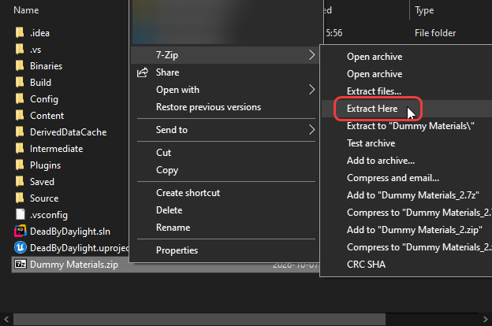
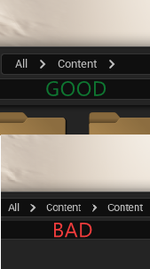
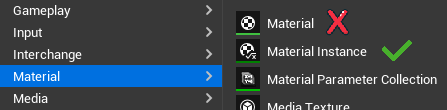
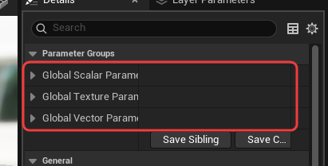
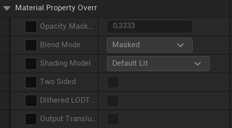

# Material Instances Guide

## Prerequisites

[FModel](../../fmodel.md)

[Unreal Engine](../../prerequisites.md)

Plugin Template Project

[Dummy Materials](link)

## Introduction

The guides in this collection will teach you about material instances and working with them in DaylightGame. This overview will go over general information and terms you should be familiar with when working with materials in any capacity in DaylightGame. It is highly recommended to understand the information here before creating mods using materials. 

If you are looking for tutorials about achieving certain effects or results from materials, please read this overview first, then look towards the specific tutorials. For example, follow [Emissive/Legacy](link) to create materials like the ones used on most glowing cosmetics. 

## Importing the materials into your Unreal Project

Download the materials then extract them into your project. You can simply place the `.zip` in the same directory as your `.uproject` and then choose `Extract Here`. The specific placement of this option may differ depending on what zip program you use.

If you're doing this in a fresh project it shouldn't prompt you to replace any existing files. After extraction, make sure that the path in Unreal Engine is `Content > ...`, not `Content > Content > ...`.

## Modding Limitations

Some things are currently not possible to mod into the game. We recommend understanding these cases before you try and fail to do something unsupported.

### Materials vs Material Instances

One important thing that limits us and influences how we work is that we **can not** create our own custom *materials*, only *instances* of ones that already exist in the game. Trying to create a base material will crash the game or show up blank. This is why you need the [dummy materials](link) so you can create your own variations of the already existing ones by manipulating their exposed parameters. The dummy materials are materials and material instances which already exist in DaylightGame, but have been recreated (credits @YourLordAdam) in the UE Editor so that we can parent our own instances to them. We never pack these dummy materials into our mods, because when loaded in the game we want our instances to look for its parent and find the *vanilla* one, which makes it work properly.

{ .center }

### Material Parameters

Materials can have 4 types of parameters, but you can only change 3 of them. 

`Scalar` parameters are numbers, such as emissive strength. 

`Texture` parameters are textures, this is what you'll use the most.

`Vector` parameters are most commonly used to control colors.

{ .center }

*All parameter types above can be changed however you want for any material.*

`Static Switch` parameters can **not** be changed arbitrarily, it will crash. They are not included in the dummy materials for this reason. If you're following the tutorials here you will never need to know what these are or touch them. However, if you're more experienced and want to enable/disable one, there is a proper way to do it; you will need to find an already existing instance in the game which has the switch combination you want, and then parent your own instance to it. It is not guaranteed that such an instance will exist.

An additional parameter category that every material instance has is `Material Property Overrides`, you can find them below the normal parameters in the same panel. They include the option `Two Sided` among a few others, which you may be tempted to touch. Unfortunately, you cant, it will crash if you touch any of these, leave them default. 

{ .center }

### Material Instance Patcher

Due to custom engine changes by the game developers, material instances need to be patched by a special program after cooking to not crash. This is included alongside our version of UnrealPak. 

## Naming Conventions

When inspecting the game files, it's good to know what different suffixes on textures usually mean. Thankfully for us, the game developers are relatively consistent in their naming convention. We highly suggest that you also follow this when making your own mods, but technically nothing forces you to for the most part.

| Texture Type | Suffix | Description |
|---|---|---|
| Diffuse | _BC | Base Color. Controls the color of the object, such as if a shirt is red or blue. |
| Normal | _N | The normal map, which affects lighting to add surface detail like creases. |
| AO Roughness Metallic | _ORM | Packs ambient occlusion, roughness, and metallic data into one texture. Mostly used to control how shiny something is. |
| Blood Dirt Emissive | _BDE | Controls where emissive effects appear on the material. |
| HideHead_Mask | _HM | Controls which parts of the mesh is hidden when playing as killer in first person. |
| Opacity Mask Texture | _M | Controls opacity. On the survivor material this is named MaskFromOtherPart. |
| Emissive_Tileable_Texture | _ET | A color ramp that gives the Emissive color a different texture. Used for multi-color emissive effects. |
| Alpha_Mask | _M | Controls alpha (transparency) for hair. |
| Depth_Mask | _M | Works as your AO (ambient occlusion). |
| RootTip_Mask | Usually _Gradiant (misspelled) | A gradient texture that controls the Root Color and Tip Color. White is the root and black is the tip. |
