# Custom Textures Guide

## Prerequisites

[FModel](../../fmodel.md)

[Unreal Engine](../../prerequisites.md)

Plugin Template Project

## Introduction

This guide will show you how to replace the BC (Base Color) texture on a skin in the game - a modification sometimes called a "recolor". The steps shown here can also be applied to any other texture in the game, not limited to skins.

Please refer to the [FModel setup guide](../../fmodel.md) if you haven't already. The rest of this guide assumes you have FModel working. 

## Exporting from the game
1. Begin by loading all game files as shown in the left image. You should then be able to expand some folders to see the main game content as seen in the right image. 

	

	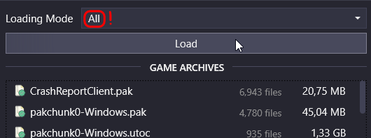

	

	

	!!! note 
		Where the texture that you want to replace is located in the files depends on which texture it is. Many environment textures are in the `Textures` folder. In modern DaylightGame versions, character skin textures and other related assets  have mostly been moved into `Plugins/DBDCharacters/`. 

2. For this guide we'll edit and then replace a jacket texture for Nea, so let's find the folder for that. I've found mine at: `******Daylight/Plugins/DBDCharacters/S05/Content/ArtAssets/Textures/Outfit037/T_NKTorso037_BC`. Thankfully, there's a reasonably standardized folder structure for most characters, so finding assets for others is often similar to this example.
	
	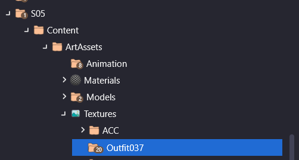{ .center width=300}

3. Click on the folder and enter grid view so we can see the textures clearly at a glance.

	{ .center}

4. Export the texture by right clicking it and selecting `Export > Texture`.

	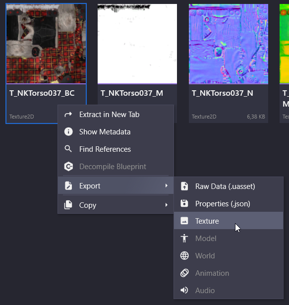{ .center width=300}

5. In the bottom right, you should now have a `Queued Items` button. Click it.
	
	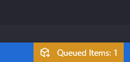{ .center}

6. You should now be seeing the export window. Click `Export` in the bottom right, then the little arrow icon next to the asset path to open the folder which the texture was extracted to.

	

	

	

	

## Editing your texture

After you've extracted desired texture, the next step is to use any program to begin editing it. For the image below [Paint.NET](https://www.paint.net/) was used since it's free and good enough for simple edits. We won't be going into how to use any imaging editing program as that's outside the scope of this guide.

When you're done editing, export your file in the highest possible PNG quality with transparency enabled to avoid ugly compression artifacts. I've edited my texture to look like this, simply recoloring it to blue. Feel free to download and use it in case you're only interested in testing the next steps.

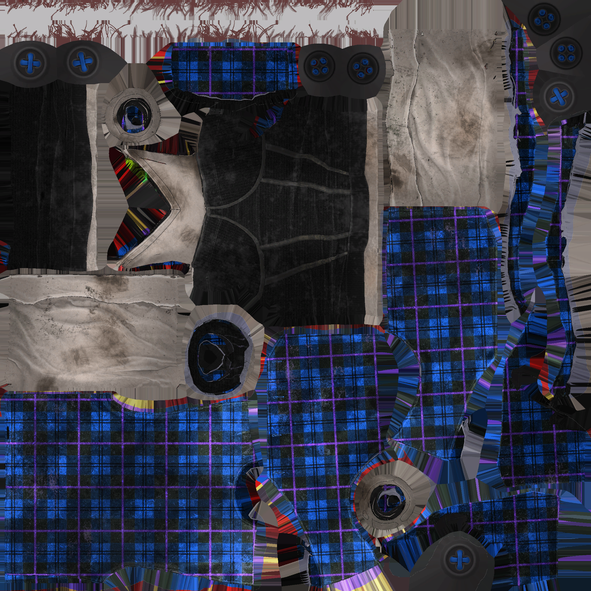{ .center width=300 }

## Importing into UE

Begin by starting up the UE DaylightGame template project. After it loads, you should see something like the image below. Let's click the `Content Drawer` button in the bottom left.

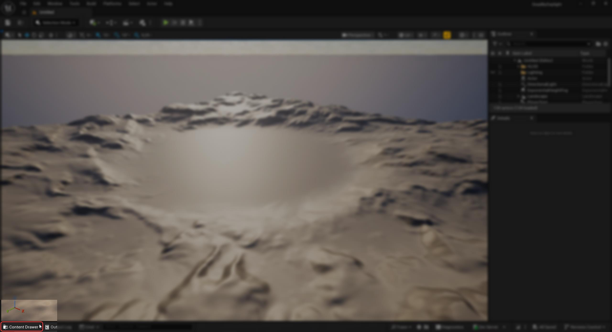

Now open the plugins folder and find the plugin of the character you're replacing a texture on, in this tutorial that is `S05`. When we open this folder it will be completely empty by default - we will need to recreate the game's folder structure so our texture gets put in the right place.

If we look in FModel we can see the folder structure we need: `Content > ArtAssets > Textures > Outfit037`. **However**, the `Content` folder is hidden and automatically created for us, so the first folder we actually create is `ArtAssets`, not `Content`. 

!!! info
	To create new folders in the content drawer, right click the empty space then choose `New Folder`, or left click the empty space then press `CTRL + N`.

Now import the texture by dragging it in from file explorer. You can see that I appended `_EDIT` to the file name while I was editing it, we need to fix this.

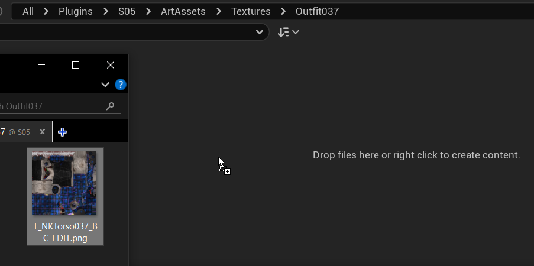

Our asset needs to be named **exactly** as it is named in FModel, otherwise it won't replace anything in the game, meaning the mod won't be visible. You can copy the exact asset name in FModel by right clicking it and choosing: `Copy > Package Name w/o Extension`.

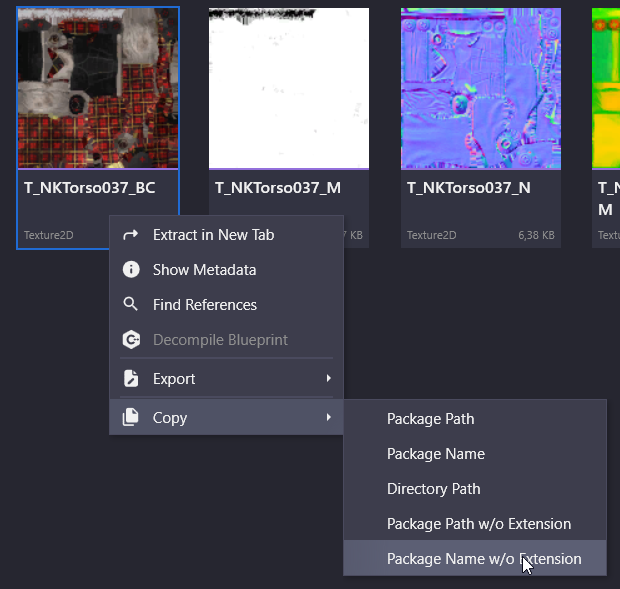

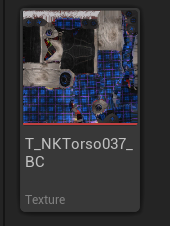

We've now placed the asset at the correct location and made sure it's named correctly. If you are replacing multiple textures, you will need to do the same for all of them. After that, the next step is cooking and packaging our mod.

## Cooking

Before cooking the mod content, make sure all the assets have been saved by pressing `Save All` in the content drawer then `Save Selected` in the popup. If you don't get a popup, that means all assets are already saved and you can continue.

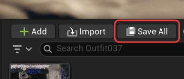

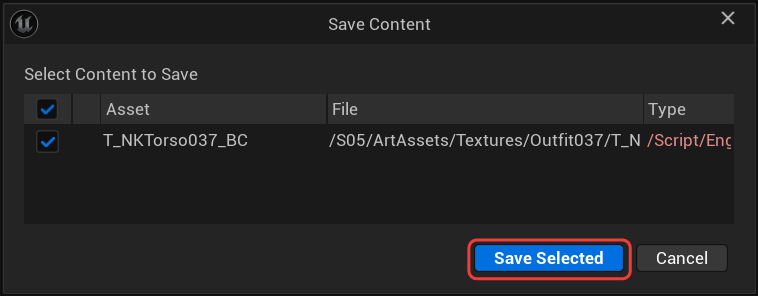

Next, in the top bar of the editor, click `Platforms > Cook Content > Cook Content`. After a few minutes - or a lot of minutes if it's your first time cooking something in the project - you'll see a `Cooking Complete` notification in the bottom right.

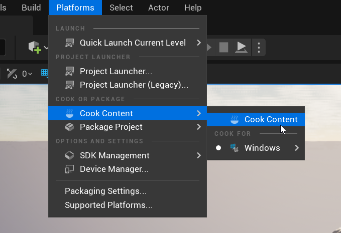{ .center width=400 }

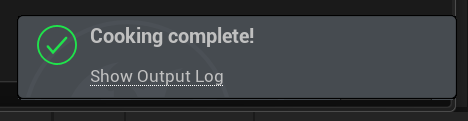{ .center width=400 }

In our cooked content directory at `{TemplateProject}/Saved/Cooked/Windows/******Daylight/` we can now see the folders `Plugins/DBDCharacters/S05/Content/ArtAssets/Textures/Outfit037/`. UE created the `Content` folder for the plugin automatically, and the path now looks exactly like in FModel.

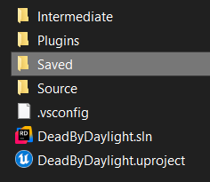

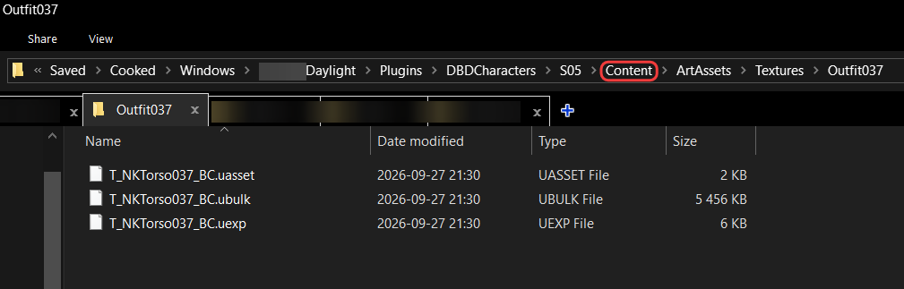

## Packaging

To pack the mod we will be using a custom UnrealPak version for DaylightGame, make sure you have it downloaded, then follow these steps:

1. Go to `{TemplateProject}\Saved\Cooked\Windows` and copy the `******Daylight` folder. 
2. Go to your UnrealPak folder and create a new pakchunk folder. 

3. Open the new pakchunk folder and paste the cooked `******Daylight` folder you copied.

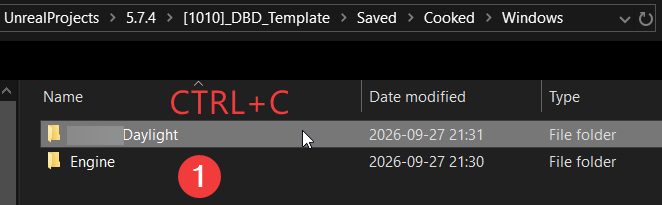

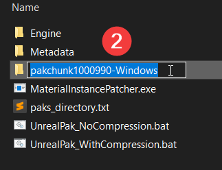

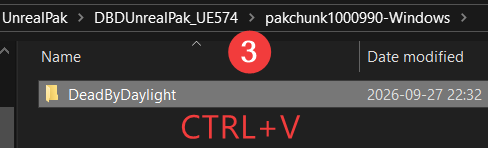{ .center }

Next, we need to remove all unnecessary assets that also got cooked. If we don't, then we would replace lots of other things which we didn't to, and the game would most likely crash or behave weirdly. **The `AssetRegistry.bin` file and `Metadata` folder should always be deleted.**

For our mod, we know that the only thing we want to replace is the `T_NKTorso037_BC` texture at `******Daylight\Plugins\DBDCharacters\S05\Content\ArtAssets\Textures\Outfit037`. Therefore, we will delete the entire *top-level* `Content` folder at `pakchunk1000{YourNumber}-Windows\******Daylight\Content` (not the plugin Content folder!). If you are replacing an asset that exists in the top-level content folder, e.g. assets not in a plugin, then you would of course not delete it.

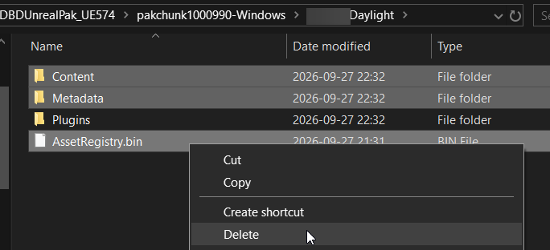{ .center width=500 }

After we've made sure we're only packing what we want, we can go ahead and run UnrealPak. It comes with two `.bat` files, one for packing with compression, and one for packing without. You almost certainly want to use the one with compression. Pack the mod by dragging the pakchunk folder over the `.bat` file.

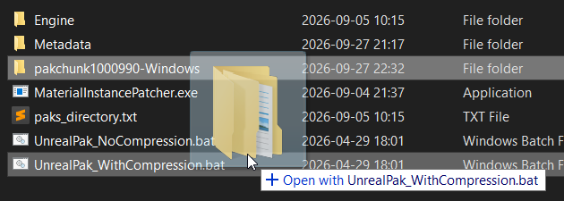{ .center width=500 }

Congratulations, the mod is complete! The `.bat` script should have automatically moved the newly packed mod into your game files, and if it didn't then something is probably wrong (check that the `paks_directory.txt` is correct). 

Depending on which mod loader/pakbypass you use, you may have to manually create a `.sig` file for the mod as well. You can do this by going to the game's Paks folder and copying any `.sig` file then renaming it to your mod's pakchunk name.
