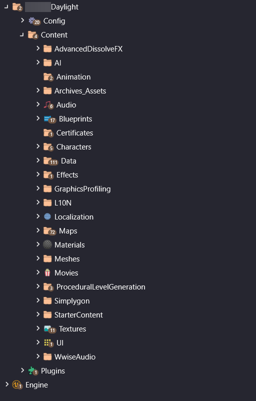
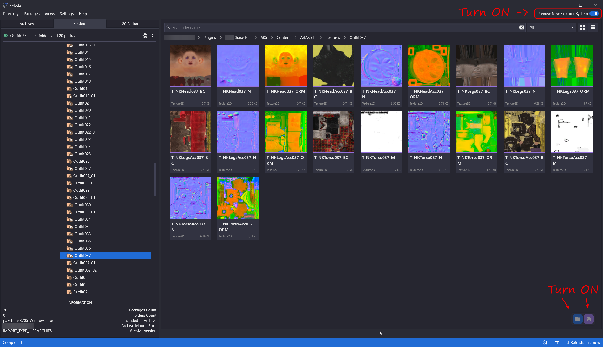
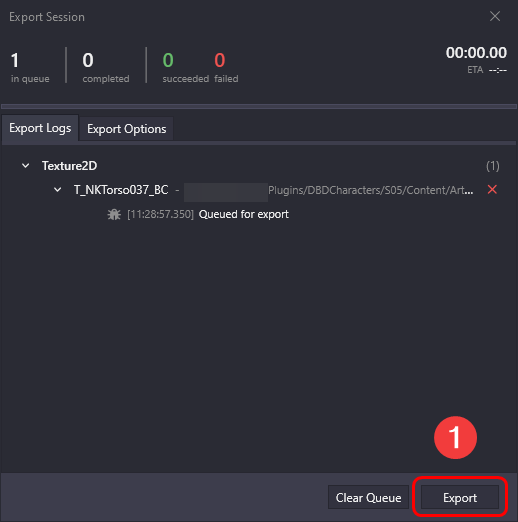
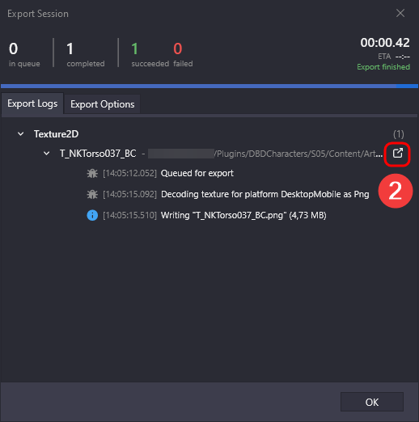
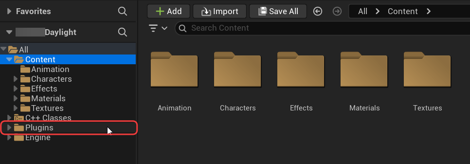
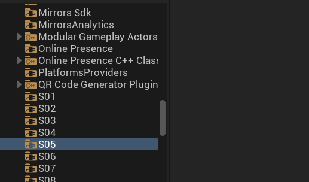
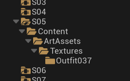
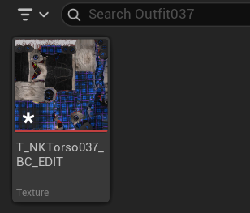

# Custom Textures Guide

## Prerequisites

[FModel](../../fmodel.md)

[Unreal Engine](../../prerequisites.md)

Plugin Template Project

## Introduction

This guide will show you how to replace the BC (Base Color) texture on a skin in the game - a modification sometimes called a "recolor". The steps shown here can also be applied to any other texture in the game, not limited to skins.

Please refer to the [FModel setup guide](../../fmodel.md) if you haven't already. The rest of this guide assumes you have FModel working. 

## Exporting from the game
1. Begin by loading all game files as shown in the left image. You should then be able to expand some folders to see the main game content as seen in the right image. 

	

	

	

	

	!!! note 
		Where the texture that you want to replace is located in the files depends on which texture it is. Many environment textures are in the `Textures` folder. In modern DaylightGame versions, character skin textures and other related assets  have mostly been moved into `Plugins/DBDCharacters/`. 

2. For this guide we'll edit and then replace a jacket texture for Nea, so let's find the folder for that. I've found mine at: `******Daylight/Plugins/DBDCharacters/S05/Content/ArtAssets/Textures/Outfit037/T_NKTorso037_BC`. Thankfully, there's a reasonably standardized folder structure for most characters, so finding assets for others is often similar to this example.
	
	{ .center width=300}

3. Click on the folder and enter grid view so we can see the textures clearly at a glance.

	{ .center}

4. Export the texture by right clicking it and selecting `Export > Texture`.

	{ .center width=300}

5. In the bottom right, you should now have a `Queued Items` button. Click it.
	
	{ .center}

6. You should now be seeing the export window. Click `Export` in the bottom right, then the little arrow icon next to the asset path to open the folder which the texture was extracted to.

	

	

	

	

## Editing your texture

After you've extracted desired texture, the next step is to use any program to begin editing it. For the image below [Paint.NET](https://www.paint.net/) was used since it's free and good enough for simple edits. We won't be going into how to use any imaging editing program as that's outside the scope of this guide.

When you're done editing, export your file in the highest possible PNG quality with transparency enabled to avoid ugly compression artifacts. I've edited my texture to look like this, simply recoloring it to blue. Feel free to download and use it in case you're only interested in testing the next steps.

{ .center width=300 }

## Importing into UE

Begin by starting up the UE DaylightGame template project. After it loads, you should see something like the image below. Let's click the `Content Drawer` button in the bottom left.

Now open the plugins folder and find the plugin of the character you're replacing a texture on, in this tutorial that is `S05`. When we open this folder it will be completely empty by default - we will need to recreate the game's folder structure so our texture gets put in the right place.

If we look in FModel we can see the folder structure we need: `Content > ArtAssets > Textures > Outfit037`. Let's recreate it in UE; you can create new folders by either right clicking the empty space then choosing `New Folder`, or left clicking the empty space then pressing `CTRL + N`.

Now import the texture by dragging it in from file explorer. You can see that I appended `_EDIT` to the file name while I was editing it, we need to fix this.

Our asset needs to be named **exactly** as it is named in FModel, otherwise it won't replace anything in the game, meaning the mod won't be visible. You can copy the exact asset name in FModel by right clicking it and choosing: `Copy > Package Name w/o Extension`.

We've now placed the asset at the correct location and made sure it's named correctly, great! If you are replacing multiple textures, you will need to do the same for all of them. After that, the next step is cooking and packaging our mod.

## Cooking and packaging

# WIP