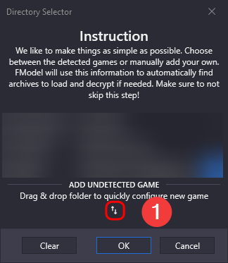
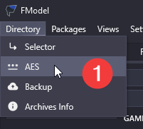
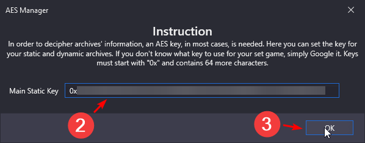
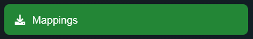
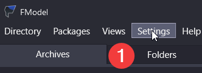
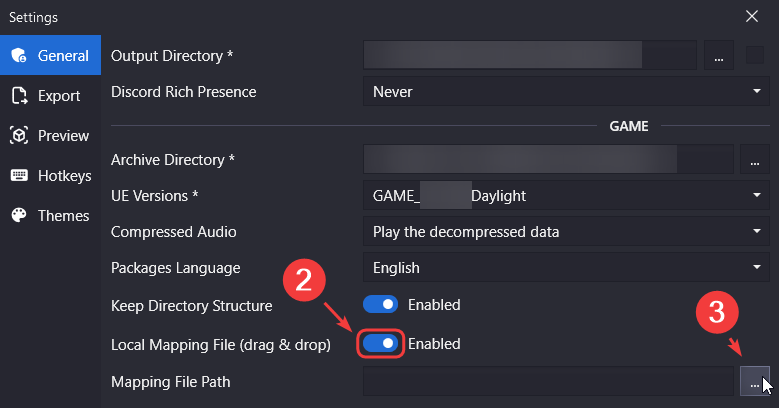
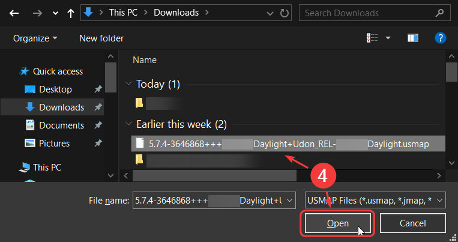
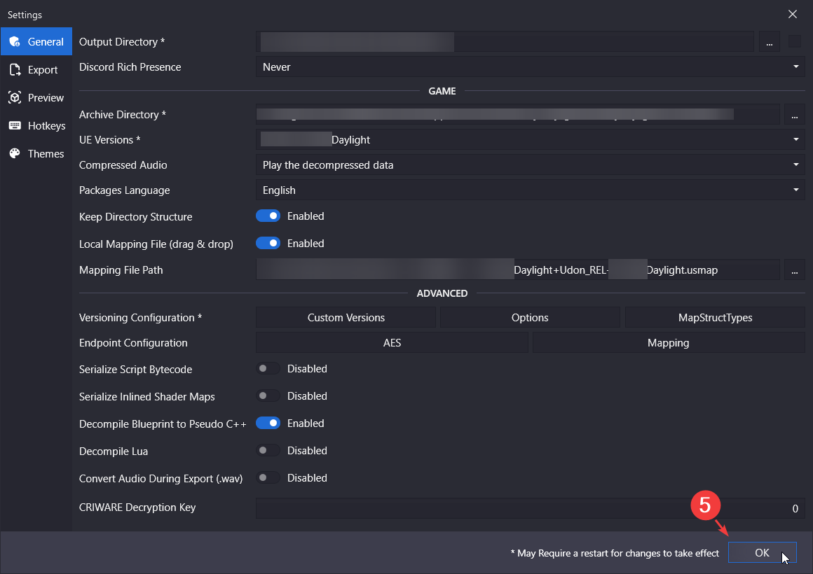

# Exploring Game Assets

This section is important to understanding how and where the game stores all its assets, which is required to modify them. We use FModel for this, a free and open-source program designed to explore various Unreal Engine games' assets. It is available on their [official website](https://fmodel.app). Save and unzip it to somewhere you can find it later.

## FModel Setup for DaylightGame

### Choosing Directory

Begin by opening FModel and clicking `Directory > Selector` in the top left corner. Then:

1. Click the icon with the two arrows ↑↓ under the `ADD UNDETECTED GAME` text.

2. Press the ... button next to the `Directory` input field, then navigate to and choose your DaylightGame `Paks` folder.

3. Press the blue + button to save this configuration. If the `Detected Game` dropdown didn't get automatically updated, make sure to select the configuration you just added. 

4. Under `UE Version` of the newly added game, select `GAME_D*****Daylight (GAME_UE5_7)`.

5. Finally, press the `OK` button

!!! note
	You can choose whatever `Name` you want for the game you're adding. If you are actively modding many different game versions it's recommended that you choose a name which reflects the game version.

### Applying AES Key

1. Click `Directory > AES` in the top left of FModel.

2. Paste the AES key into the text box. The current AES key for DaylightGame is `0x22b1639b548124925cf7b9cbaa09f9ac295fcf0324586d6b37ee1d42670b39b3`.

3. Press the `OK` button.

### Applying Mappings File

First, download the latest Mappings file by clicking the `Mappings` button in the [top right corner of this](https://deprescion.top/guides) website.
{ .center }

1. Click `Settings` in the top left of FModel.

2. In the `General` tab, enable `Local Mapping File`.

3. Click the `...` button to the right of the `Mapping File Path` textbox which should have appeared.

4. Choose the mapping file.

5. Close the settings window by pressing the `OK` button.

{ .center }

{ .center width=500 }

### You're done!

You can now load and explore game's assets! In case you struggled with any part of this, you can watch [this](https://www.youtube.com/watch?v=8pZvSYabZN4) tutorial by *ToxicShinobi*, or [this](https://www.youtube.com/watch?v=AeB0kb4DuuQ) other slightly outdated tutorial by *eefernal*. 

!!! warning
	Do note that if you're modding the latest game version you will need to use the most up-to-date **Mappings** and/or **AES Key** from above, not ones attached to these respective tutorials' video descriptions.
