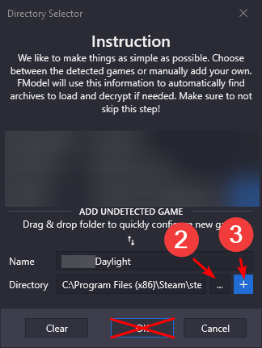
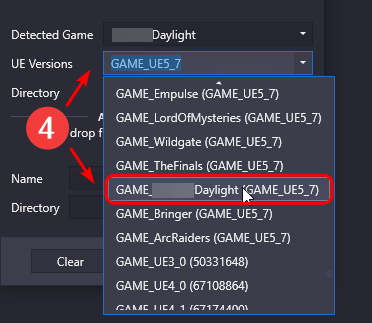
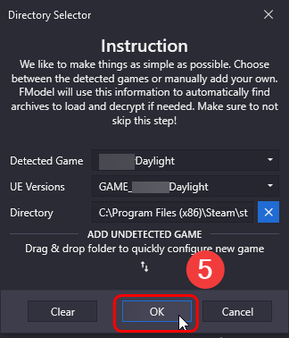

# Exploring Game Assets

This section is important to understanding how and where the game stores all its assets, which is required to modify them. We use FModel for this, a free and open-source program designed to explore various Unreal Engine games' assets. It is available on their [official website](https://fmodel.app). Save and unzip it to somewhere you can find it later.

## FModel Setup for DaylightGame

### Choosing Directory

Begin by opening FModel and clicking `Directory > Selector` in the top left corner. Then:

1. Click the icon with the two arrows ↑↓ under the `ADD UNDETECTED GAME` text.

2. Press the ... button next to the `Directory` input field, then navigate to and choose your DaylightGame `Paks` folder.

3. Press the blue + button to save this configuration. If the `Detected Game` dropdown didn't get automatically updated, make sure to select the configuration you just added. 

4. Under `UE Version` of the newly added game, select `GAME_D*****Daylight (GAME_UE5_7)`.

5. Finally, press the `OK` button

!!! note
	You can choose whatever `Name` you want for the game you're adding. If you are actively modding many different game versions it's recommended that you choose a name which reflects the game version.

### Applying AES Key

1. Click `Directory > AES` in the top left of FModel.

2. Paste the AES key into the text box. The current AES key for DaylightGame is `0x22b1639b548124925cf7b9cbaa09f9ac295fcf0324586d6b37ee1d42670b39b3`.

3. Press the `OK` button.

{ .center }

### Applying Mappings File

# OLD vvvvvv

- Download the latest Mappings file by clicking the [Mappings button in the top right corner](https://deprescion.top/guides).
- Open FModel, open the "Settings" tab at the top. Under General, enable "Local Mapping File" and set "Mapping File Path" to the downloaded Mappings file, then press OK.
- Back in FModel, click on "Directory" tab at the top left, then click on "AES" and paste in this Main Static Key: `0x22b1639b548124925cf7b9cbaa09f9ac295fcf0324586d6b37ee1d42670b39b3`
- Press OK and click on "Directory" tab one more time, this time click on "Selector", below "ADD UNDETECTED GAME" texts, click on the up/down arrow symbol.
- At the very bottom click the 3 dots on the right of "Directory" (make sure it's the bottom "Directory", below the arrows symbol from before) and locate your Game installation's Paks folder (where you normally install mods).
- As the Name, you can set it to "Dead by Daylight (LIVE)", for example, then press the blue + button, not the OK button yet. After pressing the + symbol, you'll find the top side of the panel has now been updated, the last instruction here is to select the correct UE version, click on "UE Versions" and with your keyboard begin typing "deadbydaylight", once you see GAME_DeadByDaylight (GAME_UE5_7) select it - NOTE do NOT select GAME_DeadByDaylight_OLD!
- You can then press the OK button and you should see the game's assets begin loading in. In case you struggled with any part of this, you can watch [this tutorial by ToxicShinobi](https://www.youtube.com/watch?v=8pZvSYabZN4). [Here's another slightly outdated tutorial you could use by eefernal](https://www.youtube.com/watch?v=AeB0kb4DuuQ). Do note you will need to use latest mappings from above, not ones attached to these respective tutorials' video descriptions.

